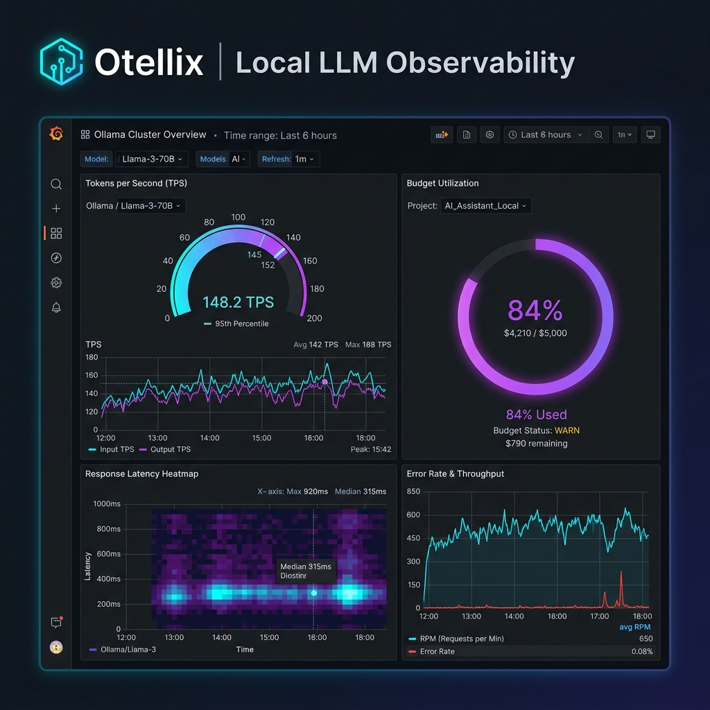

# Otellix

**Stop the LLM Bill Shock. Production-grade observability for Go backends — built on OpenTelemetry.**



<div align="center">
  <a href="https://oluwajubelo1.github.io/otellix/docs/demo/"><strong>Live Interactive Demo →</strong></a>
</div>

[](https://github.com/oluwajubelo1/otellix/actions/workflows/ci.yml)
[](https://pkg.go.dev/github.com/oluwajubelo1/otellix)
[](https://goreportcard.com/report/github.com/oluwajubelo1/otellix)
[](https://opensource.org/licenses/MIT)


---

### 💸 The Problem: "Bill Shock" is Real
Most LLM observability tools tell you what you spent *after* the money is gone. In production, a recursive prompt loop or a single "power user" can rack up thousands in costs before your billing alerts even trigger. 

**Otellix is different.** It brings real-time cost enforcement to the application layer.

---

## ⚡ Key Features

- **⛓️ LangChainGo Integration**: Drop-in `callbacks.Handler` for LangChainGo. Automatic token, cost, and span capture for chains.
- **🔌 Zero-Config Attribution**: Automatically capture `user_id` and `project_id` from Gin/Echo middleware. No more manual context plumbing.
- **🗄️ Redis Budget Store**: Distributed budget enforcement for high-availability production clusters.
- **🚀 Go-Native & High-Performance**: Built for Go 1.22+ using native streaming and OpenTelemetry. 
- **📊 Standard-Compliant (OTel)**: 100% OTel compliant. Works with Jaeger, Honeycomb, Prometheus, and Grafana.
- **💎 Prompt Caching ROI**: Track exactly how much you save with Anthropic/OpenAI prompt caching.

---

## 🚀 Quick Start

```bash
go get github.com/oluwajubelo1/otellix
```

### 🕹️ Try it Locally (Docker)
Want to see the full stack (Prometheus + Grafana) in action? Run our one-liner demo:
```bash
curl -sL https://raw.githubusercontent.com/oluwajubelo1/otellix/main/scripts/demo.sh | bash
```

---

### 1. Simple Tracing
Wrap your provider calls to get instant cost attribution and standard OTel spans.

```go
p := openai.New()
result, err := otellix.Trace(ctx, p, params,
    otellix.WithUserID("user_456"),
)
```

### 2. LangChainGo Integration
Just add the Otellix handler to your LLM configuration.

```go
import "github.com/oluwajubelo1/otellix/integrations/langchaingo"

handler := langchaingo.NewOtellixHandler(
	langchaingo.WithProvider("openai"), // required for accurate llm.cost_usd
	langchaingo.WithModel("gpt-4o"),
)
p, _ := openai.New(openai.WithCallback(handler))

// Automatically captures token usage, cost, and spans.
res, err := p.GenerateContent(ctx, parts)
```

The handler records `llm.*` attributes on a span in the context, or creates its
own `llm.call` span if none exists, so telemetry is always captured. Set
`WithProvider`/`WithModel` (LangChainGo doesn't expose them in its callbacks)
to enable cost tracking.

### 3. Middleware Attribution
Stop manually passing IDs. Use our middleware to discover identity from headers/JWTs.

```go
import otellixmw "github.com/oluwajubelo1/otellix/middleware"

r := gin.Default()
r.Use(otellixmw.GinMiddleware()) // Automatically populates context with User/Project IDs
```

### 4. Local Development
Two dev modes help you see traces while building:

```go
shutdown := otellix.SetupDev()        // (1) Pretty summary + raw OTel span JSON
defer shutdown()

shutdown := otellix.SetupDevConsole() // (2) Pretty summary only — clean terminal
defer shutdown()
```

- **`SetupDev()`** configures an OpenTelemetry stdout trace exporter (human-readable summary **and** the raw span JSON) — best for inspecting the exact span payload.
- **`SetupDevConsole()`** prints only the one-line `[otellix]` summary per call and leaves your existing `TracerProvider` untouched — ideal for demos and presentations.
- `RegisterDevPrinter()` enables just the summary printer when you already have your own `TracerProvider` configured.

---

## 📊 Standardized OTel Attributes
Otellix populates your spans with industry-standard attributes:

| Attribute | Description |
|---|---|
| `llm.provider` | The LLM provider (OpenAI, Anthropic, etc.) |
| `llm.model` | The model used (e.g. `claude-sonnet-4-6`) |
| `llm.input_tokens` / `llm.output_tokens` | Token usage for the call |
| `llm.cache_read_tokens` | Tokens served from provider cache (Savings!) |
| `llm.cost_usd` | Real-time USD cost of the call |

---

## 🏗️ Supported Providers

**Provider wrappers** (drop-in `Call`/`Stream`):

- **Anthropic**: Claude Opus/Sonnet/Haiku families with full **Prompt Caching** metrics.
- **OpenAI**: GPT-5.x, GPT-4.x, o-series, gpt-oss with caching support.
- **Google Gemini**: Gemini 3.x, 2.5, 2.0 & 1.5 Pro/Flash.
- **Ollama**: Local models with zero-dependency streaming.

**Pricing-only support** (built-in cost table for `llm.cost_usd`; bring your own provider/API): Kimi (Moonshot), DeepSeek, Qwen, GLM, ERNIE, Hunyuan, Mistral, Grok, plus every model above — 130+ models total. See [docs/providers.md](docs/providers.md).

---

## 📖 Deep Dives
*   [**Architecture**](docs/architecture.md) — How Otellix fits into the OTel ecosystem.
*   [**Budget Guardrails**](docs/budget-guardrails.md) — Redis & InMemory stores.
*   [**Integrations**](docs/integrations.md) — LangChainGo setup.
*   [**Middleware & Identity**](docs/middleware.md) — Zero-config attribution.
*   [**Prompt Caching**](docs/caching.md) — ROI analysis and tracking.

---

## 🤝 Contributing
We love stars and contributions! Please see [CONTRIBUTING.md](CONTRIBUTING.md).
Licensed under **MIT**.
